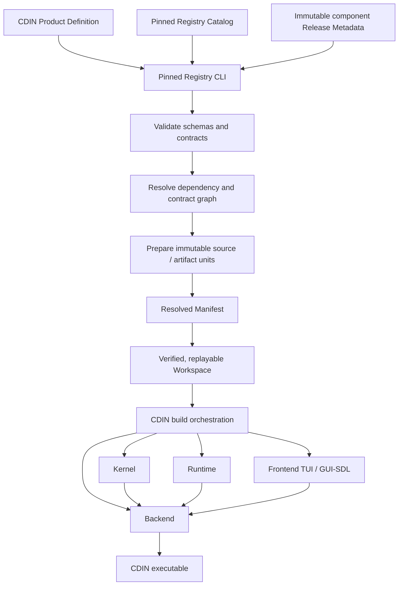
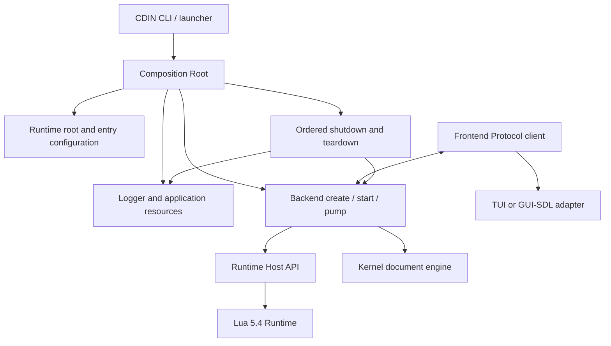

# Changelog

All notable changes to this project are documented here.

The format follows [Keep a Changelog](https://keepachangelog.com/en/1.0.0/).
Versioning follows [Semantic Versioning](https://semver.org/).

---

## [Unreleased]

### Added

- Expand the native CDIN product CI matrix to Linux x86_64/ARM64, macOS x86_64/ARM64 and Windows x86_64 UCRT64 for both TUI and GUI-SDL, with host identity checks and target/profile-qualified artifacts.

- Add a pinned Registry release-artifact bootstrap that verifies the exact Git tag, source commit, release descriptor, Catalog snapshot, asset digests and native executable architecture before use.
- Add initial artifact-consumer paths for Backend native CMake packages, Runtime Lua module archives and separate Frontend Core, TUI and GUI-SDL packages.
- Add verified exact-pin Registry cache reuse, offline operation and fail-closed handling for incomplete or corrupt cache state.
- Package the installed CDIN product prefix as native target/profile development distributions with a machine-readable build record, exact Registry Manifest, checksums and archive manifest.

- Verify installed distributions after safe extraction outside the checkout, including relocated Runtime discovery, executable version and lifecycle checks; upload each tested OS/profile bundle as a CI artifact.
- Discover bundled Runtime Lua modules relative to the installed executable while preserving explicit runtime-root overrides.

### Changed

- Keep component source builds behind explicit contributor/developer targets; the normal artifact consumer path does not silently fall back to cloning or compiling a component.
- Keep SDL3 source compilation restricted to the explicit GUI-SDL developer opt-in; TUI must never acquire SDL3.
- Validate pre-release reports against Registry's exact component/variant graph and environment-provider contracts, preserving immutable artifact descriptors, source provenance, Catalog identities and release metadata digests; reject duplicate component identities.
- Make the one-time `v0.3.0-alpha.1` release recovery forward-only: verify the existing immutable tag, create a Release only when absent, and fail without deleting or replacing any existing Release.
- Publish a unique source-only development pre-release for every successful pushed CI commit, including main, tied to the exact commit that passed CI; use the Unreleased/latest changelog section or an explicit no-changelog notice when needed.
- Keep the rolling latest application prerelease separate and gated on a successful Product Acceptance workflow on main; use least-privilege job-scoped GITHUB_TOKEN permissions instead of requiring a repository PAT secret.
- Publish pushed SemVer tags as tag-backed GitHub Releases only when the tagged commit is reachable from main; exclude the synthetic v0.0.0-dev.* source tags.

## [0.3.0-alpha.1] - 2026-11-10

### ⚠️ Breaking changes

#### CDIN is now a Registry-driven Composition Root

CDIN's architecture has been reorganized around independently versioned components and explicit product composition. This is not a routine internal refactor: the previous product-owned dependency/catalog assumptions are replaced by a build-time resolution pipeline, and consumers and contributors must follow the new ownership boundaries.

- CDIN no longer owns or embeds the component Catalog Index, component repository URLs, or per-component metadata locations. The version-controlled Catalog Index now belongs to the pinned Registry checkout.
- CDIN Product Definitions describe the products it can build (TUI and GUI-SDL); they do not duplicate component release metadata or implement dependency resolution.
- Component package versions, immutable source revisions, artifact identities and contract declarations are resolved by Registry and recorded in the Resolved Manifest. The Manifest, not an independently maintained list of versions in CDIN, is authoritative for the selected component set.
- The build now consumes Registry-prepared immutable source units and obtains component package versions from the Resolved Manifest. `deps.lock` is reserved for non-component dependencies and build-tool revisions.
- The composition root must consume installed/public component APIs. It must not include private component source/build headers or reproduce component-owned behavior.

#### Component ownership and integration contracts

The architecture separates editor responsibilities into explicit repositories. These boundaries are normative design constraints, not merely a directory layout:

| Component | Responsibility | Explicitly does not own |
| --- | --- | --- |
| Spec | Normative requirements, architecture decisions, component contracts, schemas and conformance fixtures | Runtime implementation or package discovery |
| Kernel | Canonical document bytes, transactions, versions, snapshots, undo/redo and document-level operations | UI, plugin policy, process composition |
| Runtime | Lua 5.4 commands, keymaps, configuration, plugins, views and semantic UI policy | Document storage and native UI rendering |
| Backend | Kernel adapter, Runtime Host API, OS services, sessions, protocol server, queues, worker wakeups and file services | Terminal/GUI rendering or package discovery |
| Frontend | Protocol client, input, semantic presentation model, visual layout, TUI/GUI adapters and rendering | Document ownership, Runtime policy or component resolution |
| Registry | Catalog ingestion, metadata validation, dependency/contract resolution, immutable source/artifact collection, Workspace and Resolved Manifest | Editor runtime behavior; it is a build-time tool, never linked into CDIN |
| CDIN | Product Definitions, build/install orchestration, CLI, launcher, diagnostics and process lifecycle | Reimplementing any component's domain behavior |

The public boundaries are versioned independently. In particular, the Kernel package version is not the same thing as its public C ABI; the Backend Runtime Host API and Frontend Protocol are separate compatibility contracts; Runtime's package version and Runtime Extension Contract are also distinct identities. A package upgrade must satisfy the declared dependency and contract graph rather than relying on coincidentally matching version strings.

#### New build and dependency-resolution flow

The build-time dependency flow is now:



Registry is used before compilation. It validates the Product Definition and Catalog, fetches and verifies immutable Release Metadata, resolves package dependencies and ABI/Host API/Protocol contracts, prepares the selected source or artifact payloads, emits a Resolved Manifest, and verifies/replays that Manifest into a reproducible Workspace. CDIN then builds from the prepared units. Registry is not a runtime service and is not linked, loaded, or called by the editor executable.

The GUI-SDL product is a composed product: it selects the TUI base adapter as well as the GUI-SDL adapter so that the declared fallback remains available. Product variants are selected by Product Definitions and Registry resolution, not by hard-coded component discovery in the application.

#### Runtime execution and lifecycle

The executable path is now explicitly composed through public APIs:



- CDIN creates and owns application-level resources, starts and pumps Backend, attaches the selected Frontend transport, and performs ordered shutdown and destruction.
- Backend owns sessions, protocol queues, worker wakeups, OS services and the Kernel/Runtime adapters.
- Runtime owns command, keymap, plugin and view policy. Frontend input adapters do not become a second keymap interpreter.
- Frontend owns input parsing, semantic UI state, layout and rendering. CDIN must not implement a parallel editor loop or a test-only editor session.
- Kernel remains the canonical owner of document bytes and editing history. Exact-byte behavior must be preserved, including NUL, invalid UTF-8, BOM and mixed line endings.

#### Compatibility and migration impact

- Existing local build scripts that expected CDIN to contain component metadata or to resolve dependencies directly must migrate to the Registry Product Definition / Catalog / Resolved Manifest workflow.
- Build integrations must pin the Registry checkout (including its Catalog snapshot) and honor immutable component metadata and digests.
- Direct inclusion of private component source or build-tree headers is unsupported; consumers must use installed public headers and exported package targets.
- Package versions, Kernel ABI, Runtime Host API and Frontend Protocol must be checked as distinct contracts. Do not infer ABI compatibility from a package version alone.
- Runtime prerelease selection remains explicit while the selected Runtime package is an RC. It must only be removed when a stable Runtime package and matching immutable metadata are actually published.
- The experimental POSIX TUI launch path is opt-in via `CDIN_ENABLE_EXPERIMENTAL_TUI=1`. Windows TUI remains fail-closed until a native Console readiness/input/restore bridge is implemented. GUI-SDL remains experimental and must not be advertised as a stable product.

#### Current release scope and limitations

This beta records a major architectural transition, not a declaration that the complete editor is production-ready. The Composition Root foundation and selected component integrations are merged, but the product integration epic remains open. Artifact-first publication and Catalog migration are not complete for every component; some component candidates still need immutable release assets and metadata. IME, PaneTree splitter resize and byte-anchored visible-line behavior must be selected from compatible immutable component candidates and pass live product E2E before being advertised by CDIN.

The current verification evidence is scoped to the exact tested commits and profiles recorded in `docs/development/integration-status.md`. Earlier successful candidates are historical evidence, not proof that later mainline changes or every release profile passed. The current TUI/GUI-SDL cross-platform matrix, sanitizer coverage, lifecycle/failure recovery, soak/performance baselines, clean-machine installers and signed release artifacts remain release gates.

### Added

- Introduce the Registry-driven Composition Root and separate TUI / GUI-SDL Product Definitions.
- Add a pinned Registry build-tool integration with Catalog validation, immutable component metadata resolution, contract/dependency selection, source preparation, Resolved Manifest verification and Workspace replay.
- Add a headless executable integration path that exercises the real Backend, Runtime, Kernel and Frontend session APIs, including exact-byte document fixtures and save/reopen verification.
- Add an experimental POSIX TUI launcher using Frontend-owned terminal/session/event-loop APIs, with CDIN-owned signal/wakeup handling and PTY acceptance coverage.
- Add compiler-resolved include-graph auditing to reject private component headers while permitting installed public headers.
- Add architecture policy tests for component ownership, include classification and compiler-probe trace handling.

### Changed

- Move Catalog ownership to Registry and keep CDIN responsible only for product selection and application composition.
- Replace direct component source assumptions with immutable Registry-prepared source units and Manifest-derived package versions.
- Separate the headless, experimental POSIX TUI and experimental GUI-SDL launch paths; fail closed when a platform adapter is not supported or explicitly enabled.
- Align architecture and integration documentation with the Spec ownership, compatibility and release boundaries.

### Fixed

- Select Python reliably on native Windows when GNU Make does not import `OS=Windows_NT`.
- Replace Bash-style command substitution in Make's configure target with a Python helper that reads exact package versions from the Registry Manifest.
- Make `make install` build, test and install the complete pinned profile after its component packages are available.
- Preserve exact file bytes across NUL/invalid UTF-8, BOM and LF/CRLF/CR fixtures, and cover missing-file and failed atomic-save recovery.
- Tighten CLI missing-value handling and fail-closed frontend selection.

### Verification notes
- CDIN CI run [42117574266](https://github.com/cdin-editor/cdin/actions/runs/42117574266) passed the full Windows stack, 9/9 CDIN CTest tests, six architecture tests and compiler-resolved include graph for four CDIN translation units. The headless document/file/failure fixtures passed.
- The same run passed the headless CDIN CTest and Frontend 19/19 component suite on Linux and macOS, but the live POSIX PTY test failed (9/10 root CTest tests passed). The Linux sanitizer job failed on that same PTY test.
- Frontend PR [#11](https://github.com/cdin-editor/frontend/pull/11) merged the TUI request-state lifecycle fix and regression tests as `e29df5118e7b822912724b15c0c963b0b99f2f8a`; CDIN now pins that immutable merge SHA. The current CDIN native/PTy validation is queued in [CI run 42122228431](https://github.com/cdin-editor/cdin/actions/runs/42122228431); the POSIX TUI gate remains open until that run passes.
- GitHub Code Quality's JavaScript/TypeScript job still requires a manual repository-setting correction because this repository has no JS/TS source. CodeQL Default Setup remains the scanner; verify its C/C++ and Python language selection in repository settings.

### Not yet complete
- Passing POSIX live PTY TUI E2E on the merged Frontend request-lifecycle fix.
- Native Windows Console TUI readiness/input/restore bridge and GUI-SDL launch.
- Plugin lifecycle/capability isolation, multiple Frontends, detach/reconnect and failure recovery.
- Linux/macOS compiler include-graph evidence after the TUI gate permits the task to run.
- Measured RSS/allocator peak, leak, soak and latency benchmarks.
- Clean-machine native application installers and signed application release artifacts.


## [0.2.1-beta.10] — 2026-10-14

### Breaking changes

#### cdin is now GPL-3.0-or-later

- The `LICENSE` file is the GNU General Public License v3. `README.md`'s badge and licence line say so, and `NOTICE` now lists the third-party components that keep their own licences. Code copied out of cdin, and a fork of it, are now under GPL-3.0-or-later terms rather than MIT.

### Added

* **Automated pre-release versioning and publishing.** Every qualifying push to `main` or `master` now computes the next pre-release version from Git tag history, builds Linux and Windows packages, and publishes a GitHub pre-release for the exact commit. Versions progress through `alpha → beta → rc`, increment numbered stages numerically, and start a new patch cycle after the release-candidate stage. Documentation-only changes are ignored. Pre-releases never publish macOS packages or Docker images; stable releases remain restricted to version tags without a hyphen (`vX.Y.Z`).

* **An accounting allocator every subsystem is tagged into.** `cdin_alloc` / `cdin_calloc` / `cdin_realloc` carry a `CDIN_MEM_*` tag and keep live, peak and block counts per tag; `cdin_free` reads the tag out of the header the allocator wrote, so one untagged free subtracts from the right subsystem, refuses a pointer that never came from here, and catches a double free in a debug build. A tag on `free` would mean the caller has to remember it, and a caller that remembers one wrong corrupts the one thing this exists to get right.

  It also carries a fault injector, `cdin_alloc_fail_after(n)`, which refuses every allocation after the *n*th. That is how the out-of-memory paths get exercised on purpose instead of by really running out.

  `arena_alloc` is the other half: one allocation handed out by bumping a pointer and thrown away in one step, for the paths that must not allocate at all. It is not a general allocator — nothing can free an individual allocation — so it carries a hard cap rather than growing until the process dies. Tag values are append-only and stable, because reports name them.

* **An error convention, `CdinErr`, for every fallible C function.** A small classification enum plus one out-parameter for the part that is data rather than class (a path, a line number, a token). `CDIN_OK` is zero so that `err != CDIN_OK` and `if (err)` cannot be confused by muscle memory. It carries no allocation, which is why there is no `cdin_err_free`.

* **A handle convention for every piece of C-owned state Lua can reach.** A userdata with a `__gc` and a `close()`, its type name in the metatable, and a destructor that runs exactly once. The type is `void *` at the Lua boundary on purpose: a caller cannot reach a field, cannot compute an offset into a neighbouring allocation, and cannot hand the pointer to `free()`. A closed handle is *detectably* closed — `cdin_handle_check` refuses it, so a use-after-close is a Lua error naming the type rather than a pointer into freed memory.

* **A uniform error table for the boundary.** `cdin_error_push` returns `{ code, name, detail, line, os }` rather than raising, because raising discards everything except the message and "close the document, fall back to the next font" needs something to recover with. `detail` is never nil, because a missing detail and an empty one are different facts.

* **Asynchronous file I/O off the frame thread (libuv).** `src/loop/` reads a whole file on a libuv worker and hands the bytes back to the frame thread, which splits them into lines when it is ready. This is the piece that satisfies two rules which pull against each other: the Lua state is single-threaded, and the frame must not block. So the split is by data, not by phase — a worker cannot build the line table, because that is Lua data, but it can do the part that is bytes and nothing else.

  Buffers are capped at 1 GiB and a larger file is **refused, not truncated**: a silent short read would be a corrupted document.

* **`core:memory()` — one call that says where the bytes are.** It reads the C counters the host publishes and adds what only the Lua side can know, the Lua heap and the documents. The C half is one table (`system.memory_stats`) rather than several functions, so one call is one consistent snapshot. Unavailable is `-1`, not `nil`, so a caller can subtract without a guard — and "not measurable" is never printed as "0 bytes of glyphs", which is how a regression hides.

* **The renderer's allocations are tagged `CDIN_MEM_FONT`, and its glyph cache reports `glyph_bytes` and `glyph_pages`.** Before this the renderer used raw `malloc` and was invisible to the per-subsystem report, which is why "2.1 MiB of glyphs" was a number `core:memory` knew but could not attribute.

* **Lua-visible additions.** `system.memory_stats`, `system.jobs_run`, `system.jobs_pending`, `system.alloc_fail_after`, `system.alloc_failures`, `system.alloc_fail_disable`.

* **Environment variables for diagnosis.** `CDIN_ALLOC_FAIL_AFTER=<n>` arms the fault injector at startup; `CDIN_FULL_REDRAW=1` turns damage tracking off so every frame is presented whole, which answers "is the glitch in what the cache believes is on screen?"; `CDIN_LOG_FILE` and `CDIN_LOG_LEVEL` were already there.

* **A C unit test runner.** `tests/c` covers the logger, the damage cache, the allocator, the arena and `CdinErr`, the job loop, glyph paging and the fallback chain, and the handle convention — linked against stubs so the damage cache can be driven without SDL, in its own output directory so a test run never touches the shipping binary, and built `-O0 -g3 -DDEBUG` because the allocator compiles its leak registry and free quarantine under `CDIN_ALLOC_DEBUG`, which is tied to `NDEBUG`.

* **Three fuzz harnesses and their seed corpora.** `fuzz_eol`, `fuzz_path` and `fuzz_utf8` each assert the properties that make a parser trustworthy: no read outside the input, no write outside it, no nontermination, and bytes that come back out equal to bytes that went in. That last one is what AGENTS.md §2.6 depends on. Four seeds are named `regress-*` and are kept because each found something.

* **Measurement harnesses that print numbers.** `measure_runtime.py` (startup and idle CPU), `measure_floor.py`, `measure_fonts.py`, `measure_redraw.py`, and `bench.py` — synthetic files of 4/16/64/256 MiB opened through the real `Doc` path, with the Lua heap and RSS read before load, after load, after highlighting and after close. `size.py` is now what `make size` runs; it was `bench.py`'s job, which meant asking for binary sizes started a memory benchmark.

* **`make bare`** — the runtime with an empty site directory: core, fonts and themes, no plugins, no extension manager, no cdin-x at run time. It is the only tree whose behaviour depends on nothing outside this repository, which makes it the right tree for measuring startup and deciding whether a failure is cdin's or the bundle's. `core` is copied rather than linked, because a stale core is the worst possible outcome.

* **`.luacheckrc`**, declaring the host globals. That is a contract (`docs/architecture/extension-contract.md`, "Globals and the host tables"), and a contract only written in prose is not checked.

* **`pre-release.yml` — every push gets its own version.** A push to `main` that is not documentation-only now builds Windows and Linux, reads the next version off the tag history and publishes a GitHub **prerelease** for that exact commit: `v0.2.1-alpha` → `v0.2.1-beta.1` → `v0.2.1-beta.2`, with the stage promoted (`alpha → beta → rc`) when it runs out and a new patch cycle opened after that. It reuses `release-linux.yml` and `release-windows.yml` rather than duplicating a build, and it publishes neither macOS nor Docker.

  The release body says, in Persian and English, that this is not the official build, carries the `[Unreleased]` changelog and every commit since the previous pre-release, and lists each asset with its size. `release.yml` (and the three per-platform workflows) now ignore tags with a hyphen (`'!v*-*'`), so a pre-release tag cannot trigger a stable release or a Docker Hub push.

* **`release-linux.yml` / `release-windows.yml` take a `version` input.** Left empty, both still derive the version from the tag being built, which is what a tag push gets. `pre-release.yml` passes the version it computed, which is what makes the two build paths the same build.

* **`docker.yml` runs on pull requests only.** It never pushed, but it built an image on every push to `main` — including every push that produces a pre-release. A published image still comes from `release.yml` on a stable `vX.Y.Z` tag.

* **libuv is installed by CI.** Both release workflows gained the install step, because `src/loop/` needs it and a missing dependency would otherwise surface as a wall of undefined symbols rather than as a missing dependency.

### Changed

* **`src/core/utils.c` and `src/core/boot.c` are replaced by `src/platform/`.** The platform layer is the single place in the runtime that branches on the operating system for a reason SDL cannot paper over, and it is three questions: where this binary is, what has to be set before SDL starts, and what the display's content scale is. `utils.c` and `boot.c` each carried their own `#ifdef _WIN32`, and keeping OS guards contained in one file is what stops the next platform-specific bug from arriving.

* **The file log rotates mid-session, and the logger owns the stream.** `log_add_fp` used to borrow a `FILE *` that `main.c` closed. It had to: a rotated stream has to be closed, renamed and reopened by whoever holds it, and `main.c` held it. The cap is 4 MiB, one previous run is kept as `cdin-log.txt.1`, and a crash report stays one file a person can read rather than a directory.

* **The font is a handle, and `renderer.font` is a plain table.** `renderer.font` used to *be* the metatable with `__index` pointing at itself; it is now a table carrying `load` plus every method, with the handle's metatable carrying the same methods. `f:set_tab_width(n)`, `renderer.font.set_tab_width(f, n)` and `renderer.font.load(p, s)` all still work. `getmetatable(f).__name` changes from `"Font"` to `"cdin.handle/font"` — the metatable name is not in the extension contract, but code reading it would see the new value.

* **The verification targets moved out of `mk/build.mk`** into `mk/test.mk` (the test build and the suites) and `mk/check.mk` (the state of the tree). `make help` now lists every target, grouped into what runs here and what needs a cdin-x checkout.

* **Path resolution has one implementation, and `path_absolute_alloc()` is it.** `system.absolute_path` and `path.absolute` each carried their own copy of the platform branch — `_fullpath` on Windows, `realpath` on POSIX — which is the kind of duplication that stays correct for exactly as long as nobody fixes one of them and forgets the other. The new `path_absolute_alloc()` owns the `#ifdef`, copies the CRT's result into a `cdin_alloc(CDIN_MEM_PLATFORM, …)` buffer, and frees the intermediate with `free()` on both the success and the allocation-failure path. `path_absolute()` is now a fixed-buffer wrapper that rejects insufficient capacity with the same `len >= out_size` check as before.

  Both existing contracts are unchanged: `system.absolute_path` still allocates dynamically and never imposed a length ceiling, `path.absolute` still refuses anything past `FS_PATH_MAX`, Windows still does not check existence, and POSIX still resolves symlinks. Neither API performs any encoding conversion — both still call the narrow-character CRT.

  The one behaviour that *is* new is deliberate: `system.absolute_path` can now return `nil` when the allocation is refused, where before its `malloc` buffer was unfailable in practice. That is the cost of routing the result through the accounting allocator, and it buys a path allocation that `core:memory` can attribute and a fault injector that can interrupt. The cost falls on open-file and project-scan paths, not on drawing or keystrokes.

  Windows keeps a positive `MAX_PATH` argument to `_fullpath(NULL, path, MAX_PATH)`. The CRT documents `maxLength` as *ignored* when the output buffer is NULL, but also invokes the invalid-parameter handler when it is not positive — so the constant is carried as a valid-but-inert argument rather than replaced with `0`.

### Fixed

* **The editor rendered at 1x into a HiDPI framebuffer on Linux and macOS.** `utils_get_scale` wrapped `SDL_GetDisplayContentScale` in `#ifdef _WIN32` and returned a hardcoded `1.0` for everything else, on the reasoning that "non-Windows means Unix means no scaling". That was wrong — the SDL call is cross-platform, so the guard was excluding two platforms from a value SDL was ready to give them. On a HiDPI display the window came up soft and the `SCALE` in the log lied. `plat_display_scale` now asks SDL on every platform, and treats anything below 0.5 as "could not tell" rather than scaling every coordinate to zero.

* **The editor could panic on the first frame after a font handle change.** `renderer_compat.c` kept checking the old metatable name while `renderer.font` had moved to the handle convention, so the draw path raised immediately. A name two translation units can disagree about is the whole hazard: it now lives in one header, both include it, and `api_check_font` is the one place that turns a font userdata into a `RenFont *`.

* **Using a font after `close()` dereferenced a null pointer.** The userdata held a `RenFont *` that `__gc` NULLed, so any call after collection reached `ren_get_font_size(NULL)`. This was reported by users as "the editor crashed when I closed a file", with nothing in the log to explain it. A closed handle is now refused by name.

* **A font freed while the command buffer was full was leaked.** `rencache_free_font` dropped the pointer when the buffer could not take the command. An overflow list now defers those frees to the end of the frame — the same ordering the queued path guarantees — and past the bound of that list it frees immediately and logs, rather than leaking quietly.

* **A window resize could present a stale frame.** SDL destroys and recreates the window surface on resize, restore, show and DPI change, so a replaced surface holds none of the pixels the damage cache believes are on screen. `ren_take_surface_replaced` reports the replacement and the next frame invalidates everything; `PIXEL_SIZE_CHANGED`, `MAXIMIZED`, `RESTORED`, `SHOWN` and `DISPLAY_SCALE_CHANGED` are now handled as invalidating events alongside `EXPOSED`.

* **Running out of memory while drawing terminated the editor.** Glyph pages are baked lazily from a per-frame call, so an allocation failure there arrived mid-frame with a command queue to unwind, and `check_alloc` was fatal. It is now confined to the load path — the `RenFont` struct, the font's data block, image creation — which is the tiny documented set of unrecoverable startup failures, because there is no font to draw with. The draw path returns `NULL` instead and every caller checks, so an OOM now costs the glyphs it could not bake and nothing else. The visible price is a blank region; that is preferable to terminating the editor.

* **A locked pane split out of another locked one doubled its size every frame.** `Node:get_locked_size` summed both axes. Along the split's own axis the two panes sit side by side and the sizes add; across it they share the same extent and the size is the larger of the two. Summing both meant the title bar plus a panel reported twice its height, and since each child is handed the parent's height, it doubled again.

* **`RootView:get_edge_node` picked the title bar instead of the content.** It walked down a `vsplit` always taking child `a`, which is right when the content is in `a` and wrong when it is not — `split("up", …)` puts the new row in `a`, so the search landed on the locked title-bar leaf and the panel was split out of it. It now follows the child that still holds somewhere a document can live.

* **`system.exec` could spawn a process with no name.** `MultiByteToWideChar` returning a length of 0 produced `malloc(0)`, which is a valid pointer that looks like success, and `CreateProcess` was handed an empty command line. A zero or negative length is now refused with a message naming the problem.

* **A `.deb` built from a pre-release version was rejected by `dpkg-deb`.** Debian reads the last hyphen as the boundary between the upstream version and the Debian revision, so `0.2.1-beta.1` is `0.2.1` + revision `beta.1`. The version is now rewritten to `0.2.1~beta.1`, which is valid and — because `~` sorts before an absent segment — orders *before* `0.2.1`. Stable versions carry no hyphen and are unchanged.

* **`keymap`'s reverse-mapping test failed intermittently.** `test:live` and `test:dead` are each bound to two strokes and `reverse_map` holds exactly one, so the survivor depended on table hash order, which Lua seeds from time and addresses — 7 of 10 runs gave one stroke and 3 gave another, from one unchanged table. The test now asserts the contract ("one of the strokes bound to it") plus the single-binding case a caller actually depends on.

* **`test-workflows` stopped at the first failing site mode.** It runs `empty` and `full` and reports which failed, because `full` needs the extension half present and one missing checkout directory should not hide the result for the other.

### Documentation

* **`AGENTS.md` rewritten as an owner contract.** It described a build and a repo layout; it is now the rules a contributor is held to, in the order they matter, with the reason attached to each one — because a rule whose reason is unknown gets worked around the first time it is inconvenient, and the workaround is the bug. It adds the priority order for when rules conflict (correctness and data safety over memory safety over bounded memory over latency over simplicity over modularity over brevity), the split between what an agent writes (code and tests) and what the owner writes (documentation), and §9's requirement that a check which could not be run is listed as NOT RUN with its reason.

* `NOTICE` clarifies that third-party components retain their own licences, and `README.md`'s licence line points at it.

### Known issues

* **`Doc:load` and `Doc:save` still block the frame.** They still use `io.open` plus a per-line loop on the thread that runs `core.step`; `src/loop/` exists and its completion pump runs once per frame, but no call site has been moved onto it yet. The infrastructure is what this release delivers; the `data/core/doc` conversion is the next piece of work. Until then a 256 MiB file still spends seconds in there.

* **The handle convention and the error tables have exactly one consumer each.** The font is the only handle, and `cdin_error_push` is not yet called from a binding, so neither is visible to Lua beyond that one type. `CDIN_API_VERSION` and `cdin_api_version` are compiled but not yet registered, so a plugin still has no way to ask the host's contract version.

* **The POSIX branch of `path_absolute_alloc()` has never been compiled.** This change was developed and verified on Windows/MinGW-w64 only. The `realpath(path, NULL)` branch, the two `#ifdef _WIN32` return-0 cases in the new suite, and the fixed-buffer overflow check on POSIX are all unexercised here, and ASan/UBSan, TSan and Valgrind were unavailable on this toolchain. The branch is three lines and mirrors code that already ran, but it is untested code and should be covered by a Linux or macOS CI run before anyone relies on it.

* **`ren_font_add_fallback` still stores a raw `RenFont *`.** The font handle anchors its own chain with one registry reference per fallback, which is what makes the shipped runtime safe — but a future handle type will not get that for free.

* **`system.exec` on POSIX still goes through `/bin/sh`.** It violates AGENTS.md §2.8 and is marked as such in the source. Replacing it means deciding how one command string becomes an `argv` vector, quoting rules included, and that is a user-visible behaviour change rather than a refactor.

* **`-Wconversion` is still off in the test build.** It is in the project's required warning set and the existing sources are not clean under it; `make check` and its recorded baseline cover it in the meantime.

## [0.2.1-alpha] — 2026-10-04

### Fixed

* **A side panel could not be resized by dragging its edge.** The drag was never going to work: `RootView:on_mouse_moved` wrote `node.divider`, and `calc_split_sizes` does not read `divider` when either child has a locked size — it takes the locked child's size as given and hands the sibling the remainder.

  ```lua
  local n
  if     x1 then n = x1 + ds
  elseif x2 then n = self.size[x] - x2
  else         n = math.floor(self.size[x] * self.divider)
  ```

  So every frame of every drag moved a number the next layout pass discarded, and the pane kept the width it had. `get_locked_size` is the read side of a contract whose write side — `set_locked_size(axis, value)` on the pane's view — nothing in `data/core/` had ever called.

  `Node:drag_divider` now asks the split which side is locked before deciding where the delta goes: no locked side moves `divider` exactly as before; a locked side gets the delta through the hook, `a` growing as the pointer moves right and `b` shrinking; a locked side whose view has no hook falls back to the divider, which is no worse than before and honest about there being nothing to talk to. Both ends clamp — eight cells, because a pane narrower than its own edge cannot be grabbed again, and because the layout would otherwise hand the sibling a negative size.

  cdin-x's treeview has implemented `set_locked_size` since it was written, so it resizes on the first load of this. cdin-x's manager panel implemented nothing, so it does not; that half is cdin-x's, and until it lands that one panel is draggable only with <kbd>[</kbd> and <kbd>]</kbd>.

* **The divider was thinner to grab than anything else on screen.** The hit test used a margin of six *pixels* on every display, while the rule itself is `1 * SCALE` wide — three logical pixels either side of it on a 2x screen. The report was "the cursor does not change to a resize icon", which is the same fact as "the drag does not start": the hover and the press ask the same question, and the answer was no.

  The margin is in cells now, six of them — which is what six pixels was at 1x, so the zone widens on a scaled display and is unchanged on an unscaled one. Wider still starts costing the panel its own right-aligned column.

### Documentation

* `docs/architecture/extension-contract.md` documents `set_locked_size` beside `attach_side_view`: it is part of the side-panel interface now that something calls it, and an extension writing a panel from that page needs to know the axis is named rather than assumed.

* `docs/guides/commands.md` says where the mouse resizes a split, next to the keyboard bindings that go quiet while a locked pane holds focus.

## [0.2.0-alpha] — 2026-10-03

cdin is now the editor **runtime**. The extension set a build ships is assembled at build time from a [cdin-x](https://github.com/m-mdy-m/cdin-x) checkout.

### ⚠️ BREAKING CHANGES

#### cdin is the runtime; the extension set is built from cdin-x

- `data/` contains only `core/`. `data/plugins/`, `data/themes/` and `data/fonts/` are removed from the source tree.
- `make` runs `scripts/assemble_data.py`, which links the source `core/` into `build/<platform>-<build>/data/core` and runs `<CDINX_DIR>/scripts/bundle.py` for everything else. `CDINX_DIR` defaults to `../cdin-x`.
- `make bin` compiles the binary only and needs no cdin-x. `make bundle` assembles `data/` and needs cdin-x. With no cdin-x reachable, `make` fails with an explicit message.
- `--no-plugins` no longer disables vim. Bundled plugins are mandatory and always load; `config.plugins` selects the *site* set only.
- `config.plugins`: `nil` (default) loads every site plugin, `false` loads none, a table is a whitelist.
- The loader has two roots: `EXEDIR/data/plugins` (bundled, mandatory) and `config.site_dir/plugins` (site, selected by `config.plugins`). A bundled plugin wins over a site plugin of the same name. `plugins.list()` reports `source = "bundled" | "site"`.
- `package.path` gains the site directory, appended (never prepended), so a site cannot shadow `core.*` or the bundled `X.core.vim.*`.
- Workflow commands moved to cdin-x: `core:find-command`, `core:find-file`, `core:open-file`, `core:open-folder`, `core:reload-module`, `core:open-user-module`, `core:open-project-module`.
- `ctrl+p`, `ctrl+shift+p` and `ctrl+o` are no longer bound by the runtime. `ctrl+n` stays.
- The empty view's shortcut help is no longer hardcoded; extensions contribute rows via `core.register_help_shortcuts`.
- The empty view delegates open-file to `core:open-file` through `command.perform` (silent no-op when no plugin registers it).
- The release workflows and the Dockerfile package the assembled `build/…/data`, and check cdin-x out inside the workspace, passing its location as `CDINX_DIR`.
- The contract is documented in [`docs/architecture/extension-contract.md`](docs/architecture/extension-contract.md).

#### Removed from the runtime

Unreferenced symbols, none on a live path:

| Removed | File |
|---------|------|
| `plugins.autoload_list` | `data/core/plugins.lua` |
| `core.on_error` | `data/core/lifecycle.lua` |
| `core.runtime.temp` module, `core.temp_filename` | `data/core/runtime/temp.lua`, `data/core/init.lua` |
| `core.close_log_file` | `data/core/logging.lua` |
| `help.count` | `data/core/help.lua` |
| `common.utf8_len`, `common.bench` | `data/core/utils/common.lua` |
| `Object:implement` | `data/core/utils/object.lua` |
| `command.names_of` | `data/core/input/command.lua` |
| `fs.ext`, `fs.stem`, `fs.split`, `fs.normalize`, `fs.is_absolute` | `data/core/fs.lua` |
| `config.theme_auto_reload`, `config.line_limit`, `config.optional_plugins` | `data/core/config.lua` |
| `style.caret_block_alpha`, five `vim_pill_*` fallbacks | `data/core/style.lua` |
| `doc_search` local | `data/core/views/docview.lua` |
| `core.views`, `core.utils`, `core.input`, `core.runtime` aggregators | four `init.lua` files |
| `autoupdate` | removed entirely; updating cdin is the user's job |

#### Moved to cdin-x

| Was | Now |
|-----|-----|
| `data/plugins/` (core, languages, optional, tab, treeview, vim, window) | assembled from cdin-x at build time |
| `data/themes/*.lua` (10 themes) | `cdin-x/X/themes/<name>/theme.lua`; `default` is bundled |
| `data/fonts/` | `cdin-x/fonts/`, copied to `data/fonts` next to the binary |
| `data/user/init.lua` | not bundled; `config.user_dir/init.lua` is read if present |
| `data/core/git/` | git plugin, registered via `core.register_vcs_provider` |
| `data/core/commands/findreplace.lua` | `find-replace` plugin |
| `data/core/search.lua` | cdin-x, or the C `search` API |
| `data/core/session_bootstrap.lua` | `data/core/preboot.lua` (rewritten) |
| `core.load_plugins()` | `core.plugins.load_all()` in `data/core/plugins.lua` |

`core.git.*` is now a hook: `core/project.lua` and `core/views/statusview.lua` read `core.vcs_provider`. With no git plugin loaded, ignored-file markers and the status-bar branch render nothing.

### Added

#### Plugin loader

- `data/core/plugins.lua`: a plugin is a directory with `init.lua`, or a single `.lua` file. The entry point is read with `dofile()` (may return a manifest) and `init(core, config)` is called if present.
- Load order is deterministic: sorted by name within each root, bundled root first.
- A failing bundled plugin is logged at error level; a failing site plugin is logged and skipped. The editor starts either way.
- `config.plugins` is read through `config.site_path()` at the point of use.
- `--no-plugins` is the command-line equivalent of `config.plugins = false`; it is applied after `config.user_dir/init.lua` has run. `-u NONE` is accepted as a spelling.
- User config runs before plugins, so a plugin can override a keymap set in `init.lua`.
- New commands in `data/core/commands/plugin.lua`, registered without a predicate: `core:load-plugin`, `core:unload-plugin` (both accept a comma-separated list) and `core:list-plugins`. Changes do not persist across restarts.

#### Extension points

| API | Purpose |
|-----|---------|
| `core.register_help_shortcuts(list) → handle` | contribute rows to the empty view's Quick Reference |
| `core.unregister_help_shortcuts(handle)` | remove those rows on unload |
| `core.register_status_pill(key, provider)` | colored badge at the left of the status bar; `provider()` returns `nil` or `text, bg_style_key, fg_style_key` |
| `core.register_recent_provider(provider)` | supplies `open_recent_picker` / `open_recent_dirs_picker` |
| `core.register_vcs_provider(provider)` | `status.branch`, `status.is_ignored`, `refresh_ignored_now` |
| `core.set_project_dir(path) → ok, reason` | validates, normalises, chdirs, updates `core.project_dir` / `core.project_files` / revision, drops the cached scan |
| `core.themes.add_root(dir)`, `core.themes.rescan()` | register a themes root |
| `core.style.set_fallback(key, hex)` | register a style fallback |
| `command.add(predicate, map, overwrite)` | third argument lets a plugin re-register its own name |
| `command.remove(names)` | remove exactly the commands a plugin registered |
| `keymap.remove(map)` | detach named commands from a stroke |
| `RootView:attach_side_view(view, side, opts)` | attach a side panel to a layout edge; idempotent, does not steal focus |
| `RootView:detach_view(view)` | release the space on unload |
| `config.data_dir` | published so extensions can see what a build ships |

- The help registry lives in `data/core/help.lua`.
- `core.themes` discovers `<root>/<name>/theme.lua` across `config.user_dir/themes`, `EXEDIR/data/themes` and extension-added roots (sorted, earlier roots win). A persisted `config.theme` is re-applied after plugins register their roots.
- `config.site_dirname` (default `"site"`) names the site directory; `config.site_dir` overrides it with a full path. `config.data_home` and `config.sep` are exported.

#### Build

- `mk/bundle.mk` holds the entire cdin → cdin-x coupling (`CDINX_DIR`). The `build:` recipe moved there from `mk/build.mk`.
- `scripts/assemble_data.py` (stdlib only, Python 3.8+, no network):
  - recreates the `data/core` symlink on every run (copy fallback where symlinks are unavailable);
  - runs `<CDINX_DIR>/scripts/bundle.py --out <data>` with the same interpreter;
  - unlinks, never traverses, a symlink left at the output path (on Windows any reparse point counts as a link);
  - fails with a clear message when cdin-x is not reachable.

#### Tests

| Target | Reads | Runs |
|--------|-------|------|
| `make test-plugins` | `scripts/fixtures/` only | `scripts/test_commands.lua`, `scripts/test_lua.lua` |
| `make test-lua` | fixture tree only | `tests/lua/run.lua` |
| `make test-workflows` | cdin-x via `CDINX_DIR` | `scripts/test_workflows.lua` |
| `make test-site-dir` | cdin-x via `CDINX_DIR` | `scripts/test_site_dir.lua` |

- `scripts/_stub_env.lua`: pure-Lua stand-in for the C `fs` / `path` / `system` modules.
- `test_lua.lua` runs the loader and theme registry eight times (site present/absent × `config.plugins` = `nil` / `false` / `{demo}` / `{raiser}`), each in its own process.
- `test_workflows.lua` asserts that workflow commands are registered, that `ctrl+p`, `ctrl+shift+p`, `ctrl+o` and `ctrl+shift+o` each have exactly one command, that the runtime keymap names none of them, and that unloading `palette`, `finder` and `modules` detaches commands and strokes.
- `test_site_dir.lua` guards that cdin's `config.site_dirname` and cdin-x's installer agree.
- `tests/lua/unit/keymap_stroke_test.lua` pins which stroke spellings the input layer can build.
- `tests/lua/` now has a target; two files that required the moved `data/themes/` were fixed to use fixtures.

#### Logging

- One log file: `cdin-log.txt` (was `cdin.log`; rotated copy `cdin-log.txt.1`). The Lua stream is mirrored into it by default, tagged `LUA`, with `core.try` tracebacks. `CDIN_LUA_LOG=0` disables the mirror.
- The file is opened once per run in line-buffered append mode, written at `LOG_DEBUG` (was `LOG_TRACE`), and rotated at startup past 4 MB.
- `CDIN_LOG_LEVEL`, `CDIN_LOG_FILE_LEVEL` and `CDIN_LOG_FILE` override level and path.
- `Ctrl+Shift+L` opens the log (`core:open-log`).
- In the log view, `F2` switches between `core.log_items` and the C logger's file; `Ctrl+R` re-reads the current source. The header shows the file name and size.

#### Documentation

- New: `docs/architecture/extension-contract.md`, `docs/guides/extensions.md`, `docs/README.md` (index with reading order).
- Rewritten for the split: `docs/architecture/overview.md`, `docs/architecture/internals.md`.
- Updated: `docs/guides/plugins.md`, `configuration.md`, `commands.md`, `building.md`, `getting-started.md`, `troubleshooting.md`, `README.md`, `CONTRIBUTING.md`, `AGENTS.md`.
- Removed `themes.md`, `syntax.md`, `vim-keybindings.md`; they now point to cdin-x's `a-theme.md`, `a-syntax-definition.md` and `plugins/vim.md`.

### Changed

- **Boot order:** parse flags → build views → `command.add_defaults()` → read `config.user_dir/init.lua` → apply `--no-plugins` → `core.plugins.load_all()` → re-apply persisted theme → load project module → open command-line files. A plugin-loading failure no longer force-opens the log view.
- **Runtime keymap:** 152 → 85 bindings. Treeview, tab, window, autocomplete, session, project-search and find-replace groups moved to plugins. `ctrl+d` keeps `doc:select-word`; `find-replace` prepends `find-replace:select-next` at load. `ctrl+f`, `shift+r` and `ctrl+shift+h` are no longer runtime bindings.
- `ctrl+tab` / `ctrl+shift+tab` are no longer bound by the runtime.
- `root:*-tab*` commands renamed to `root:*-pane-view*` (`root:switch-to-{next,previous}-pane-view`, `root:move-pane-view-{left,right}`, `root:switch-to-pane-view-1…9`). Old names remain as aliases.
- The status bar's vim-mode pill is now a generic pill registry; pills draw left to right in registration order.
- `command.add_defaults()` discovers `data/core/commands/*.lua` from disk and requires `core.rootview.node` and `core.views.logview` up front.
- `core/style.lua` reads fonts from `config.fonts_dir`.
- `data/core/preboot.lua` replaces `session_bootstrap.lua`, with a `recent` → `recent_files` migration for older state files.
- The extension manager is marked `essential` and ships with every build (`Ctrl+Shift+M`, or `M` in vim normal mode).
- `core.quit` asks the loop to stop instead of calling `os.exit()`; `core.run()` returns and `main()` unwinds the window. Extensions wrapping `core.quit` must keep their wrapper synchronous.

### Fixed

- The "cdin needs cdin-x" error now prints the resolved `CDINX_DIR` it probed, states that the default is a sibling directory, and lists the extension manager in the mandatory set.
- `scripts/test_commands.lua` reported a hardcoded stroke count; it is now counted from `keymap.map`.
- Dead core keybindings:
  - `command.add_defaults()` skipped `data/core/commands/command.lua`, leaving `Return`, `Tab`, `Escape`, `Up` and `Down` bound to unregistered commands.
  - `empty_view.lua` and `logview.lua` registered commands at require time but were required lazily, so `ctrl+o` / `ctrl+shift+o` (empty view) and `ctrl+c` / `ctrl+a` (log) named commands that did not exist yet.
  - `core:open-folder` was called but never defined.
- Themes now apply: `data/core/themes.lua` defined `style.set_theme` against an undeclared global `style`, which raised inside a swallowed `pcall`. The duplicate method is removed.
- Lua edits reach the editor on Windows: `ln -s` under MSYS silently copied, and the `[ ! -e ... ]` guard made the copy permanent. `assemble_data.py` recreates the link every build and `_sync_data_windows` is removed.
- Core no longer requires an extension at startup: the registry sync required `X.core.git.exec`, crashing startup with `module 'X.core.git.exec' not found`.
- Install and update scripts install a runnable editor: `find_data_dir()` now recognises an assembled tree by its `BUNDLE.lua` and prefers `build/*/data`; `update.py` copies the assembled tree and fails loudly if none exists; `scripts/cdin.py build` passes `BUILD=` and `CDINX_DIR=`.
- `log:switch-source` was bound to `["ctrl+s+l"]`, a stroke the input layer cannot build. It is bound to `f2`.
- `keymap.add` records strokes it cannot build in `keymap.unreachable`, and `core.init` reports them once after boot.
- `make` could not generate the icon header: `mk/build.mk` called `gen_icon.py` with removed flags (`--out`, `--no-inl`), and `--out` was ambiguous under `argparse` prefix matching. It now uses `--out-inl`, depends on the real generator, and honours `PYTHON`.
- The second of two locked side panels was given the whole window; `calc_split_sizes` now honours every locked child's requested size.
- A pane collapsing next to a locked pane raised instead of collapsing; `Node:collapse` now clears the lock before installing the empty view.

### Documentation fixes

- Docs were verified against the code in both repositories. Four things cross the boundary: vim, the extension manager, the `default` theme and the fonts.
- Installing extensions does not clone anything: the manager fetches `X/manifest.lua` and the files of the chosen extension over HTTPS into a staging directory. A cdin-x checkout is needed only to build cdin or work on cdin-x.
- Every optional extension now lists its keys and collisions: `Alt+J/K/L`, `Ctrl+D`, `Ctrl+R`, `Ctrl+Shift+D` and `F2`. On a fresh build only `Ctrl+Shift+M` and `Ctrl+Shift+L` are bound by cdin-x content.
- `Ctrl+Shift+M` and `Ctrl+Shift+L` are bound by the runtime's own bundle.
- `--no-plugins` and `config.plugins = false` affect the site directory only. Extensions installed by the manager (stored under `<data_home>/cdin/extensions/X`) and the mandatory set still load.
- `init.lua` cannot `require` a site plugin's module: the loader extends `package.path` at the start of `load_all()` (step 11), after `init.lua` (step 9). The correct prefix is `plugins.<name>.…`.
- The Lua log is mirrored into `cdin-log.txt` (tag `LUA`, with tracebacks) unless `CDIN_LUA_LOG=0`.
- `doc:delete-to-next-char` exists; it is generated and unbound.
- Extension manager details corrected: lowercase keys, `Esc` is the only exit, no `q`, index ~18 KiB, title-bar counts show matches during search, `Return` enables/disables. Precedence differs: the loader takes the first name seen (bundled beats site); the manager takes the last root scanned (a site checkout beats the bundle).
- A theme installed from the manager is written to the store and listed but not registered as a theme root, so it does not reach the theme switcher and `config.theme` cannot find it by name.
- `make check` runs `scripts/check.py`, which does not exist; there is no lint or style checker (the compiler runs at `-Wall -Wextra` without `-Werror`).
- `make debug-san` sets `SANITIZE=1`, which no makefile reads; it is equivalent to `make debug`.
- `building.md` no longer claims SDL2 is supported; `mk/build.mk` requires `SDL3/SDL.h`.
- `configuration.md` no longer claims user config loads last; it loads before plugins.
- UTF-8 corruption (mangled em-dashes and box-drawing characters) removed from six `docs/` pages.

### Build, packaging & CI

- `make` = `bin` + `bundle`; `make CDINX_DIR=/path` points the bundle at another checkout.
- The three release workflows check cdin-x out at `./cdin-x` inside the workspace (`actions/checkout` refuses a `path` outside `GITHUB_WORKSPACE`, so a `../cdin-x` sibling is not possible) and export `CDINX_DIR` to the build through `GITHUB_ENV`. `docker.yml` checks it out at `./cdin-x` and the `Dockerfile` copies it to `/cdin-x`.
- The release workflows and the `Dockerfile` package the assembled `build/…/data`. No `CDINX_DIR` is baked into the image.
- Trailing-newline fixes in the release workflows and the Dockerfile.

### Migration (from 0.1.3)

| You had | Do this |
|---------|---------|
| `data/plugins/<name>` | the plugin is in cdin-x; a build bundles the mandatory set, and `config.plugins` selects what is installed in your site directory |
| `data/themes/<name>.lua` | `<name>/theme.lua` in a themes root; user themes go in `<config_home>/cdin/user/themes/<name>/theme.lua` and win over bundled ones by name |
| `data/fonts/*.ttf` | cdin-x; the build copies them into `data/fonts` next to the binary |
| `config.optional_plugins.<name> = false` | removed |
| keymaps naming `find-replace:*`, `tab:*`, `window:*`, `treeview:*`, `session:*`, `project-search:*`, `autocomplete:*`, `core:find-command`, `core:find-file`, `core:open-file`, `core:open-folder`, `core:reload-module`, `core:open-*-module` | bind only if the matching cdin-x plugin is installed (`core:load-plugin` or add to `config.plugins`) |
| `core.git.*` | `core.vcs_provider.status.*` via `core.register_vcs_provider` |
| `require "plugins.<name>"` across extensions | `require "X.core.<name>"`; an extension's own modules are `require "plugins.<name>.…"` |
| `require` of a site plugin's module from `init.lua` | move it into that plugin's `init()` or a command |
| `config.site_dir = "<path>"` | still works; `config.site_dirname` renames the directory under the data home |

### Known issues

- **Four of the five start-screen shortcuts do nothing.** `↑` `↓`, `Tab`, `Return` and `Esc` are printed by the empty view but unreachable: `events.lua` routes key presses only to `keymap.on_key_pressed`, and nothing calls `EmptyView:on_key_pressed`. `Ctrl+N` and clicking a recent item work.
- **Three keystrokes change meaning once certain extensions are installed:** `Ctrl+R` stops reloading the log (`treeview:rename-key`), `Ctrl+Shift+D` stops duplicating a line (`session:open-recent-dirs`), `F2` stops switching the log stream (`treeview:toggle-key`). The later-loaded extension wins; rebind in `init.lua`, which runs before every plugin. See `docs/guides/extensions.md`.
- The mandatory bundle must be self-contained: every `require "X.…"` inside an essential plugin must resolve inside its own subtree. This is checked by cdin-x's `make validate`.
- `make`, `make bundle`, `make test-workflows` and `make test-site-dir` need a cdin-x checkout. `make bin`, `make test-plugins` and `make test-lua` do not. No target fetches cdin-x.
- `empty-view:open-folder` is a silent no-op unless a plugin registers `core:open-folder`.
- Bundled vim and site-installed integrations can come from different cdin-x versions, with no version negotiation. `X.core.vim.registry` is the compatibility surface.
- Broken make targets: `check` and `size` call missing scripts (`scripts/check.py`, `scripts/bench.py`); `test` and `bench` are `.PHONY` with no rule; `debug-san` sets an unread `SANITIZE=1`. `make help` still claims plugins and themes ship inside `data/`.
- C-level test tiers (unit / integration / e2e) do not exist; all tests cover the Lua data layer under plain `lua`.
