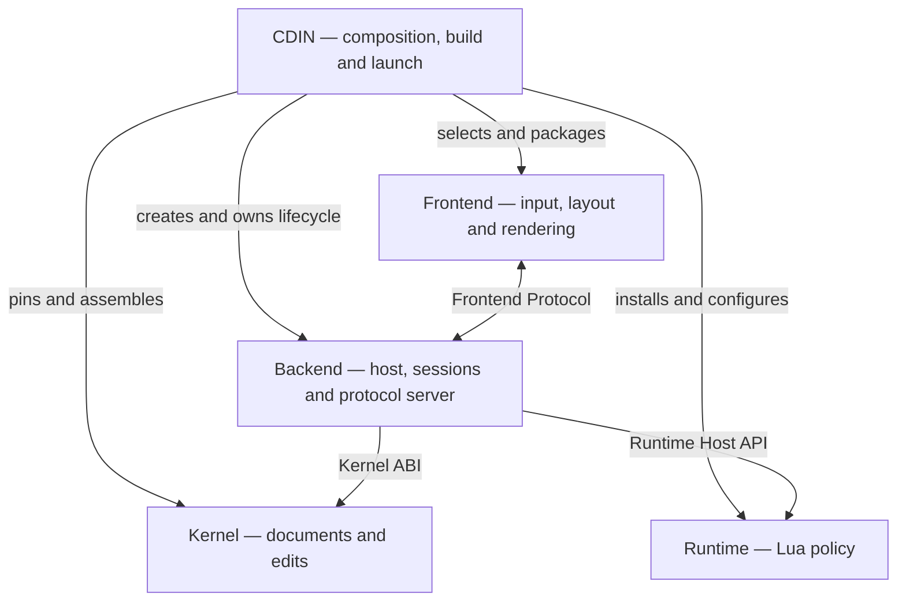

# Architecture

This document describes how the CDIN Composition Root fits the editor components, which process state it owns, and what the current executable actually connects.

The [CDIN Specification](https://github.com/cdin-editor/spec) is authoritative for component contracts. This document describes the current implementation and must not be used to promote a proposed Spec requirement to accepted status.

## 1. The component boundary

| Component | Owns | Does not own |
| --- | --- | --- |
| Kernel | Canonical document bytes, versions, edits, transactions, snapshots and undo/redo. | Files, windows, editor keymaps or frontend rendering. |
| Runtime | Commands, keymaps, configuration, plugin policy, logical views and semantic UI state. | Canonical document bytes or visual layout. |
| Backend | Kernel integration, Runtime host, sessions, OS services, protocol server, queues and transport. | Display-toolkit rendering or frontend layout. |
| Frontend | Input adaptation, visual layout, text presentation and rendering. | Documents, keymap policy or private Backend APIs. |
| CDIN | Dependency pins, build/package orchestration, launcher and process lifecycle. | Editor-domain state and component implementations. |

The intended dependency direction is:

This is a composition diagram, not permission for CDIN to call private component APIs. Backend is the only component that directly integrates Kernel. Runtime reaches documents through the Backend Runtime Host API. Frontends communicate through the Frontend Protocol.

Normative references: [ARCH-001](https://github.com/cdin-editor/spec/blob/main/docs/architecture/overview.md#L113-L113), [ARCH-040–046](https://github.com/cdin-editor/spec/blob/main/docs/architecture/module-boundaries.md#L65-L71) and [ROOT-001](https://github.com/cdin-editor/spec/blob/main/docs/components/cdin.md#L22-L22).

## 2. What the Composition Root owns

The CDIN executable currently owns only a small amount of application state:

- parsed launcher options;
- its `m-mdy-m/log.c` logger handle;
- the Backend handle returned by `cdin_backend_create`;
- the selected Runtime module root and entry name.

It does not own document buffers, keymaps, plugin registries, visual layouts or frontend sessions.

The native source is deliberately small:

| Path | Responsibility |
| --- | --- |
| `src/main.c` | CLI dispatch, compatibility guards, Backend lifecycle and exit status. |
| `src/cli/options.c` | Parsing the Composition Root command-line options. |
| `src/diagnostics/log.c` | CDIN logger setup and Backend-to-logger severity adaptation. |
| `include/cdin/options.h` | Private launcher option contract. |
| `include/cdin/log.h` | Private logger adapter contract. |

These are application-composition modules, not public editor APIs.

## 3. Startup sequence

The current `--check` path is:

1. Parse the command line. Help and version return without starting components.
2. Reject an unsupported frontend or an interactive launch request. Only the headless check path is enabled.
3. Create the CDIN logger using the pinned `m-mdy-m/log.c` library.
4. Verify the Backend runtime version against the headers used to build CDIN.
5. Initialize Backend configuration with the Runtime module root, Runtime entry point, Lua enabled and headless protocol enabled.
6. Route Backend log records into the CDIN logger callback.
7. Create Backend, start it, pump once and shut it down.
8. Destroy Backend and release the CDIN logger.

The implementation is in [`src/main.c`](https://github.com/cdin-editor/cdin/blob/feature/complete-composition-root-rewrite/src/main.c#L24-L80).

The current CLI does not launch a live Frontend process. A compile-time check compares the Backend and Frontend Protocol major/minor constants. That proves the headers agree at build time; it does not prove a transport session or user input path works.

## 4. Shutdown and ownership

Backend is created by CDIN and remains owned by CDIN until destruction. If creation fails, there is no Backend handle to release. If startup or pumping fails after creation, CDIN still enters the cleanup path, requests shutdown and destroys the handle.

The logger outlives Backend because Backend's log callback uses the logger context. CDIN therefore destroys Backend before closing the logger. This is the required lifetime order for the current callback.

The exact semantics of document/session shutdown remain owned by Backend and Kernel; CDIN must not duplicate them.

## 5. Runtime assets

The pinned Runtime repository is checked out by the development stack builder. CMake installs its `lua/` tree under `share/cdin/lua` inside the selected prefix. CDIN passes the configured root and entry module to Backend; Backend owns the Lua state and Runtime Host bridge.

CDIN must not embed a second Lua policy layer or expose a new keymap/plugin API.

## 6. Link-time dependencies and public contracts

The Composition Root finds the installed Frontend Core package and logger package, and links the installed Backend, Backend services, Protocol codec and Kernel package required to complete the static link. The Kernel package appears in the link closure because Backend is currently built as a static library; CDIN source does not include Kernel headers or call Kernel APIs.

The current build applies these guards:

- Lua must be PUC Lua 5.4.x.
- Kernel package version must be at least 1.2.1.
- Logger package must be compatible with 0.1.0.
- Frontend Core package must be compatible with 1.0.0.
- Backend runtime version must match the Backend headers used at build time.
- Backend and Frontend Protocol major/minor constants must match.

See [Dependency matrix](development/dependency-matrix.md) for immutable source revisions and the limits of these checks.

## 7. Frontend integration is not complete

The pinned Frontend repository currently builds Core, Headless and the experimental TUI target in the stack workflow. CDIN does not yet create a Frontend client, attach it to Backend or run the TUI event loop.

The TUI must multiplex input, Backend readiness/messages, resize and termination events without busy-waiting, and must restore terminal state through all handled exit paths. That requirement is [FE-019](https://github.com/cdin-editor/spec/blob/main/docs/components/frontend.md#L82-L82). Until the actual readiness/wakeup path is implemented and verified, interactive launch stays fail-closed.

## 8. Boundaries to preserve

- No Kernel implementation, document buffer or undo history in CDIN.
- No Runtime command, keymap or plugin implementation in CDIN.
- No Backend session, job queue or transport implementation in CDIN.
- No Frontend input parser, visual layout or renderer in CDIN.
- No website source or website deployment in this repository. The site lives in [cdin-editor.github.io](https://github.com/cdin-editor/cdin-editor.github.io).

The independent repositories and their immutable revisions are listed in [Dependency matrix](development/dependency-matrix.md).
